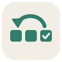
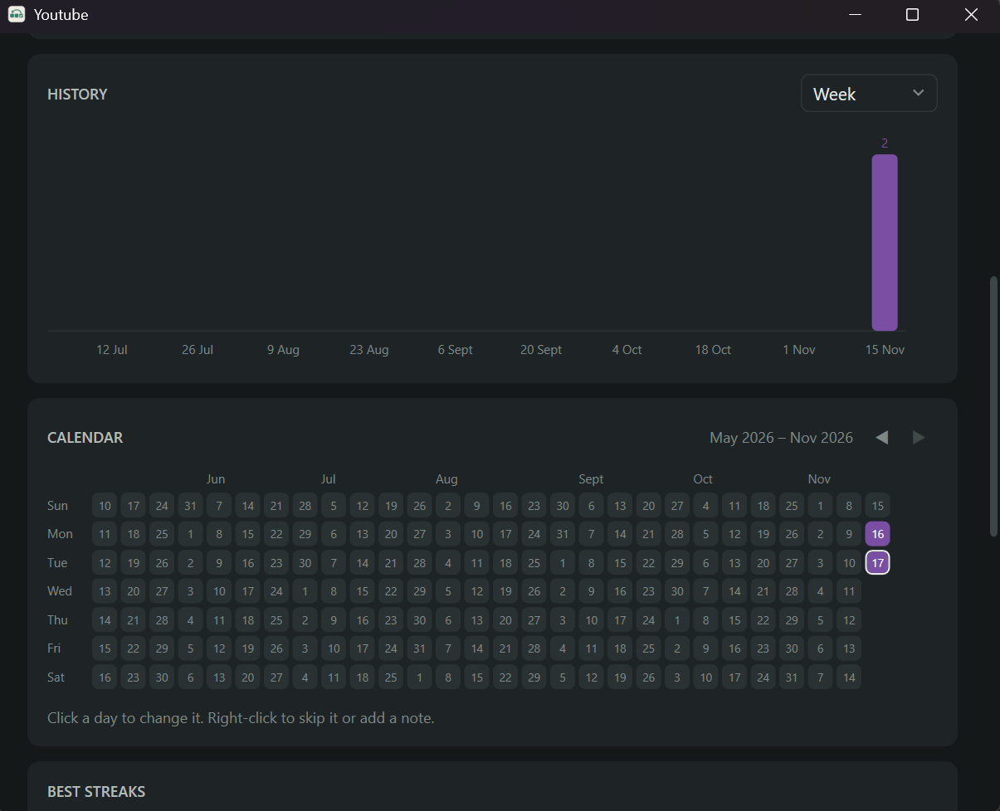
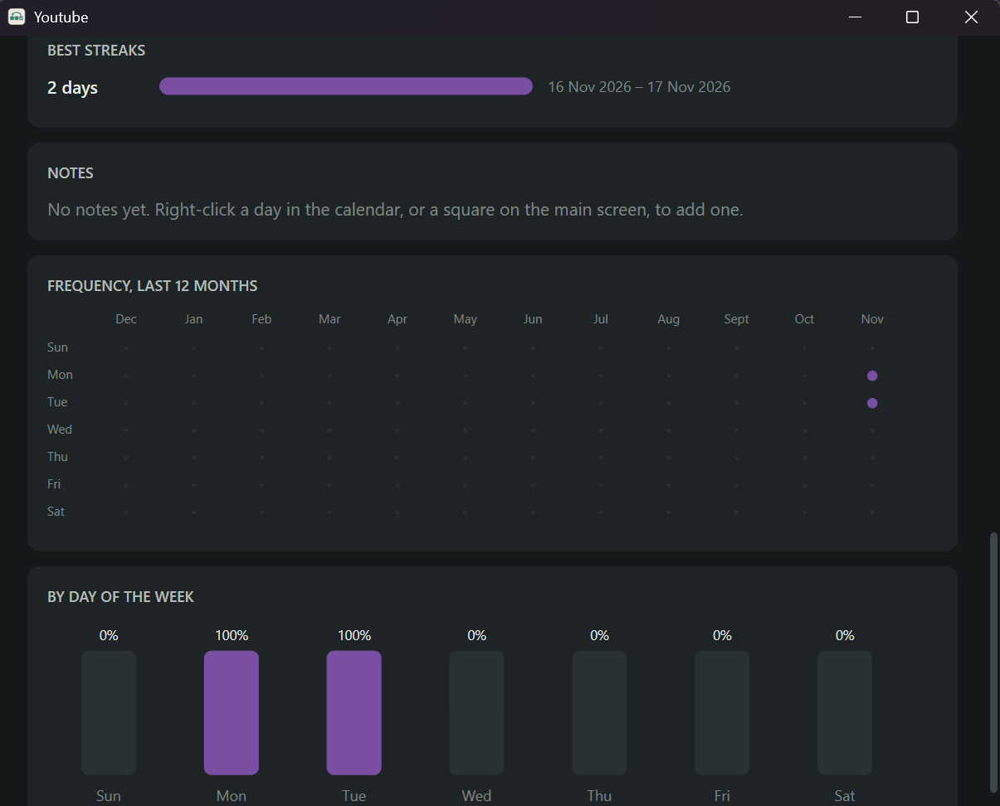

<div align="center">



# Recur

**A simple, private habit tracker for Windows.**

Build good habits, track your streaks, and watch habit strength grow. No account, no cloud, no ads.

[](https://github.com/GGpranav23/Recur/releases/latest)
[](https://github.com/GGpranav23/Recur/actions/workflows/release.yml)
[](https://github.com/GGpranav23/Recur/releases)
[](#install)
[](https://dotnet.microsoft.com/)
[](LICENSE)

[**Download for Windows**](https://github.com/GGpranav23/Recur/releases/latest) · [Features](#features) · [Screenshots](#screenshots) · [Build from source](#build-from-source)

<br>


</div>

## Why Recur?

Most habit trackers only count streaks, so one missed day resets everything. Recur gives each habit a **strength** score that rises with consistency and fades slowly, so a single slip doesn't wipe out weeks of progress. It's quick to use every day, and the detailed history is there when you want it.

Recur is inspired by the excellent [Loop Habit Tracker](https://github.com/iSoron/uhabits) for Android. It's an independent app written from scratch in C# and WPF, and it shares no code with Loop.

## Features

**Tracking**
- **Yes-or-no habits.** For example, "Did you meditate today?"
- **Measurable habits** with a daily target and unit, such as *at least 20 pages*, or a limit, such as *at most 2 cups of coffee*.
- **Flexible schedules:** every day, once a week, once a month, or every few days.
- Check in from the main screen with one click. Right-click a day to **skip** it or **add a note**.

**Insights**
- **Habit strength**, plus how it has changed over the last month and year.
- **Current and best streaks**, and the number of days completed.
- **Strength and history charts** by day, week, month, quarter or year.
- A **calendar** you can scroll back through and edit directly.
- **Frequency over the last 12 months**, and your **success rate by day of the week**.

**Everyday use**
- **Reminders** at a time you choose, from a small icon in the system tray.
- **Sort and filter:** sort by your own order, name, color, strength or what's left today. You can also hide habits you've done today, and archive habits while keeping their history.
- **Light, dark or Match Windows** theme, with title bars that follow it.
- You choose the **first day of the week**, or let Windows decide.

**Your data**
- Everything is stored **only on your computer**, in a single SQLite file.
- **Back up and restore** with one click, which also moves your habits to a new PC.
- **Export to CSV** to open your full history in Excel.

## Screenshots

<table>
  <tr>
    <td width="50%"></td>
    <td width="50%"></td>
  </tr>
  <tr>
    <td align="center"><sub><b>Habit details:</b> strength, streaks and trend</sub></td>
    <td align="center"><sub><b>History and calendar:</b> click any day to change it</sub></td>
  </tr>
  <tr>
    <td width="50%"></td>
    <td width="50%" align="center"></td>
  </tr>
  <tr>
    <td align="center"><sub><b>Patterns:</b> best streaks, notes, frequency and weekdays</sub></td>
    <td align="center"><sub><b>Settings:</b> theme, calendar and your data</sub></td>
  </tr>
</table>

## Install

1. Download **`Recur-vX.Y.Z-win-x64.zip`** from the [latest release](https://github.com/GGpranav23/Recur/releases/latest).
2. Unzip it to a folder of your choice, such as `%LOCALAPPDATA%\Programs\Recur`.
3. Run **`Recur.exe`**.

Recur is a single self-contained exe, so you don't need to install .NET or anything else. It needs Windows 10 or 11 (64-bit).

> [!NOTE]
> The exe isn't code-signed yet, so Windows SmartScreen may warn you the first time you run it. Click **More info → Run anyway**.

<details>
<summary><b>Start Recur with Windows (optional)</b></summary>

<br>

1. Press <kbd>Win</kbd> + <kbd>R</kbd>, type `shell:startup` and press <kbd>Enter</kbd>.
2. Create a shortcut to `Recur.exe` in the folder that opens.
3. Open the shortcut's **Properties** and add ` --tray` to the end of **Target**.

Recur will then start quietly in the system tray when you sign in, ready to send reminders.

</details>

## Your data

All habits, check-ins, notes and settings are stored in one file on your PC:

```
%LOCALAPPDATA%\HabitApp\habits.db
```

Recur never connects to the internet. To move your habits to another computer, use **Settings → Back up…** on the old PC and **Settings → Restore…** on the new one. Before a restore, Recur saves a copy of your current data as `before-restore.db` in the same folder.

## Build from source

**Requirements:** Windows and the [.NET 10 SDK](https://dotnet.microsoft.com/download). Visual Studio 2022 (17.13 or later) or 2026 with the *.NET desktop development* workload also works. Open `HabitApp.slnx` in it.

```powershell
git clone https://github.com/GGpranav23/Recur.git
cd Recur

# Run
dotnet run --project HabitApp

# Build the single-file release exe (output: publish\Recur.exe)
dotnet publish HabitApp/HabitApp.csproj -c Release -r win-x64 --self-contained true -p:PublishSingleFile=true -o publish
```

### Releases

Releases are built by [GitHub Actions](.github/workflows/release.yml). To ship a new version:

1. Update `<Version>` in `HabitApp/HabitApp.csproj` and push to `main`.
2. Publish a new release on GitHub with a tag such as `v1.1.0`.
3. The workflow builds `Recur.exe` and attaches `Recur-v1.1.0-win-x64.zip` to the release.

### Project structure

```
HabitApp/
├── App.xaml(.cs)              App start-up, single-instance handling, shared styles
├── MainWindow.xaml(.cs)       Habit list with recent check-ins
├── DetailWindow.xaml(.cs)     Strength, streaks, charts, calendar and notes for one habit
├── HabitDialog.xaml(.cs)      Window for creating and editing habits
├── SettingsWindow.xaml(.cs)   Theme, first day of the week, backup, restore and export
├── NoteDialog.cs              Dialog for adding a note to a day
├── NumberDialog.cs            Dialog for entering a measurable habit's amount
├── Habit.cs                   Habit model
├── Stats.cs                   Strength score and streak calculations
├── Database.cs                SQLite storage (Microsoft.Data.Sqlite)
├── Preferences.cs             Theme and calendar preferences
└── TrayIcon.cs                System tray icon and reminder notifications
```

## Contributing

Bug reports, ideas and pull requests are welcome. Please [open an issue](https://github.com/GGpranav23/Recur/issues) to report a problem or discuss a bigger change before you start on it.

## Acknowledgements

- [Loop Habit Tracker](https://github.com/iSoron/uhabits) by Álinson S. Xavier, the inspiration for Recur's approach to habit strength.
- [Microsoft.Data.Sqlite](https://learn.microsoft.com/dotnet/standard/data/sqlite/) and [SQLite](https://sqlite.org/).

## License

Recur is released under the [MIT License](LICENSE). © 2026 Pranav Shinde
