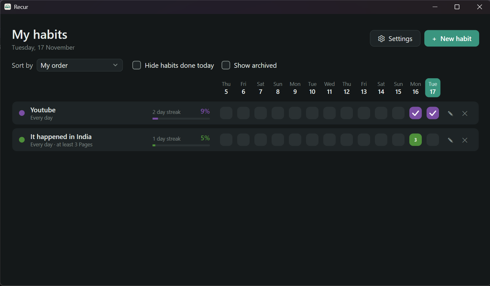
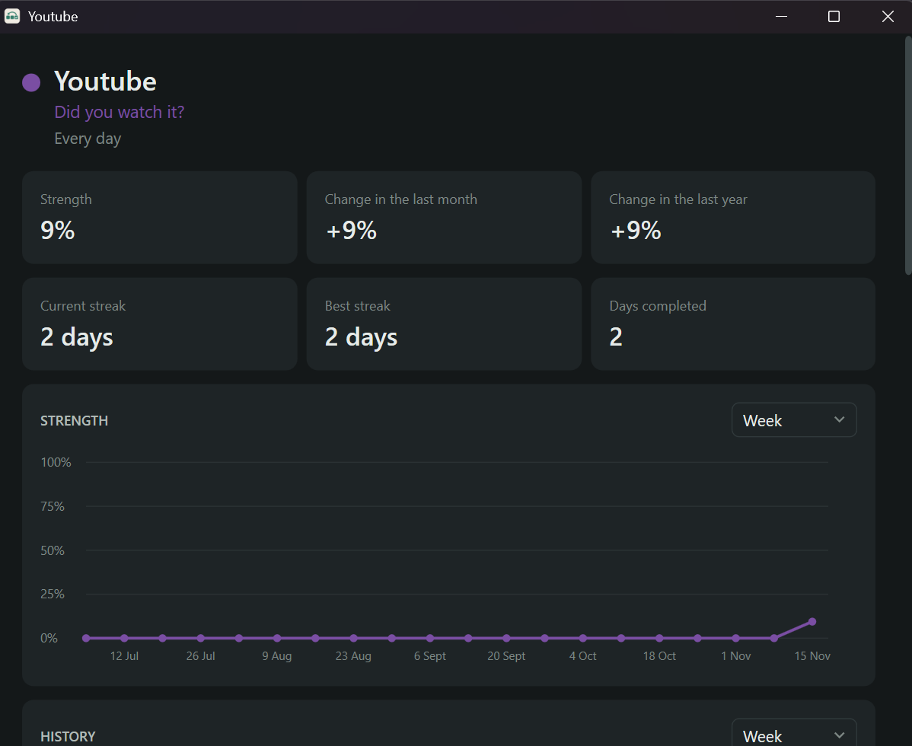
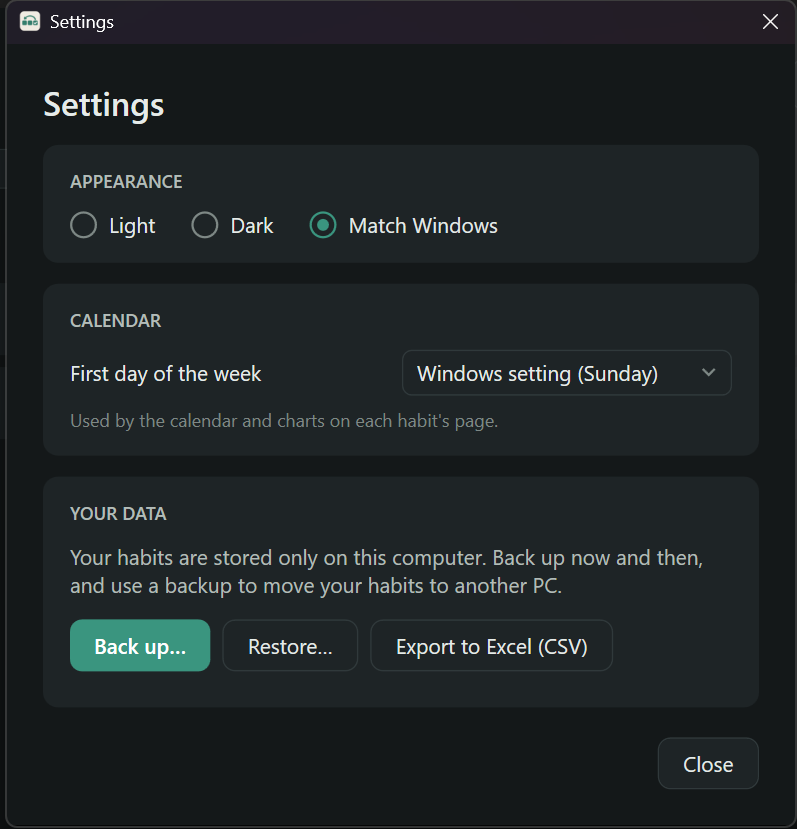

<p align="center">
  
</p>

<h1 align="center">Recur</h1>

<p align="center">
  A simple, private habit tracker for Windows.<br>
  <a href="../../releases/latest"><b>Download the latest release</b></a>
</p>

---

Recur helps you build good habits and drop bad ones. Tick off each day and Recur shows how strong each habit has become over time. Your data stays on your computer: there's no account and no cloud.

Recur is inspired by [Loop Habit Tracker](https://github.com/iSoron/uhabits) for Android. It's a separate app written from scratch in C# and WPF, and it shares no code with Loop.

## Screenshots

| My habits | Habit details |
|---|---|
|  |  |

| New habit | Settings |
|---|---|
|  |  |

## Features

- **Yes-or-no and measurable habits.** Track "Did you meditate today?" or "Read at least 20 pages". "At most" targets work for limits such as "at most 2 cups of coffee".
- **Flexible schedules.** Choose every day, once a week, once a month, or every few days.
- **Habit strength.** A score that rises with consistency and fades slowly, so one missed day doesn't erase your progress.
- **Detailed history.** See a calendar, streaks, your best streaks, frequency by day of the week, and history charts by week, month, quarter or year.
- **Notes and skips.** Right-click a day to add a note or mark it as skipped.
- **Reminders.** Recur runs in the system tray and can remind you at a set time.
- **Organize.** Reorder habits, sort them, hide the ones you've done today, or archive a habit while keeping its history.
- **Light and dark themes.** You can also match Windows, and set which day the week starts on.
- **Your data, your files.** Back up and restore with a single `.db` file, or export your full history to CSV for Excel.

## Install

1. Download `Recur-vX.Y.Z-win-x64.zip` from [Releases](../../releases/latest).
2. Unzip it anywhere, for example `C:\Users\<you>\AppData\Local\Programs\Recur`.
3. Run `Recur.exe`.

The exe is self-contained, so you don't need to install .NET. Recur needs Windows 10 or 11 (x64).

> Windows SmartScreen may warn you the first time you run Recur, because the exe isn't code-signed. Click **More info → Run anyway**.

**Start with Windows (optional):** press <kbd>Win</kbd>+<kbd>R</kbd>, type `shell:startup`, and add a shortcut to `Recur.exe` with `--tray` after the path. Recur then starts hidden in the tray, ready to send reminders.

## Where your data lives

All habits, check-ins, notes and settings are kept in one SQLite file:

```
%LOCALAPPDATA%\HabitApp\habits.db
```

To move your habits to another PC, use **Settings → Back up…** on the old PC and **Restore…** on the new one.

## Build from source

You need the [.NET 10 SDK](https://dotnet.microsoft.com/download) on Windows. Visual Studio 2022 (17.13 or later) or 2026 with the **.NET desktop development** workload also works.

```powershell
git clone <this repo>
cd Recur

# Run in debug mode
dotnet run --project HabitApp

# Build the single-file release exe
dotnet publish HabitApp/HabitApp.csproj -c Release -r win-x64 --self-contained true -p:PublishSingleFile=true -o publish
```

The release exe is created at `publish\Recur.exe`.

When you push a tag such as `v1.0.1`, GitHub Actions builds the exe and publishes it as a release automatically (see [`.github/workflows/release.yml`](.github/workflows/release.yml)).

## Project layout

| File | Purpose |
|---|---|
| `MainWindow` | The habit list with the last few days' check-ins |
| `DetailWindow` | A habit's strength, calendar, streaks and charts |
| `HabitDialog` | The window for creating and editing habits |
| `SettingsWindow` | Theme, start of the week, backup, restore and export |
| `Database.cs` | SQLite storage (Microsoft.Data.Sqlite) |
| `Stats.cs` | The calculations for strength, streaks and scores |
| `TrayIcon.cs` | The system tray icon and reminder notifications |

## License

[MIT](LICENSE) © 2026 Pranav Shinde
